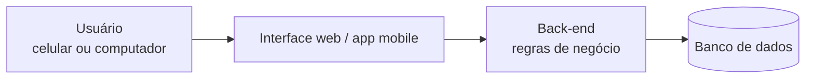
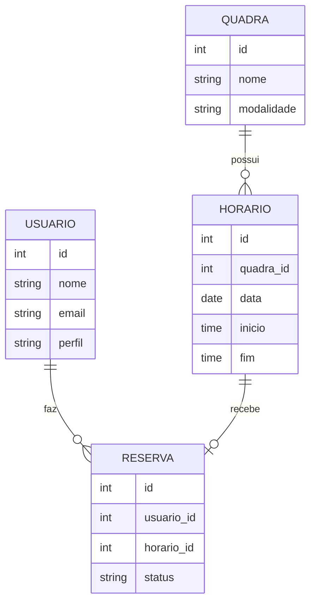

# Arquitetura e modelo de dados — Alugar

> Versão preliminar. A arquitetura final depende das tecnologias escolhidas.

## 1. Visão geral

O sistema é dividido em três partes:

| Camada | Função | Situação |
|---|---|---|
| Interface | Telas de consulta, reserva e administração. | Protótipo mobile publicado |
| Back-end | Regras de negócio (ex.: impedir reservas duplicadas). | A definir |
| Banco de dados | Armazenamento de quadras, horários, usuários e reservas. | A definir |

## 2. Modelo de dados (preliminar)

## 3. Regras de negócio

1. Um horário só pode ter **uma** reserva ativa.
2. Somente usuários autorizados pelo condomínio podem reservar.
3. O usuário só pode cancelar as próprias reservas; o administrador pode cancelar qualquer uma.
4. Reservas canceladas liberam o horário.

## 4. Protótipo e decisões de design

- O protótipo mobile foi criado com Lovable: https://sporty-reserve-app-mobile.lovable.app/
- Decisão: priorizar o uso em celular, pois moradores tendem a reservar de forma rápida pelo telefone.

## 5. Decisões técnicas pendentes

| Decisão | Opções consideradas | Situação |
|---|---|---|
| Tecnologia do back-end | A definir | Pendente |
| Banco de dados | A definir | Pendente |
| Hospedagem do sistema | A definir | Pendente |

Registre aqui cada decisão tomada, com a data e o motivo.
